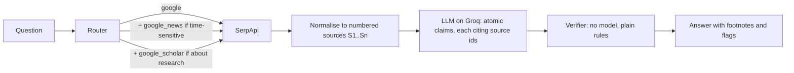

# Footnote

Search-grounded answers where every claim carries a footnote, and every footnote is checked.

Most "grounded" LLM answers attach a list of links and hope. Footnote makes the model cite a specific search
result for every sentence, then checks each citation without a model: does the cited result exist, does it contain
every number the sentence states, and how much of the sentence it actually covers. Anything that fails is flagged
in the output instead of being presented as fact.

`footnote audit` applies the same idea to Google's AI Mode: it checks every figure in an AI Mode answer against the
pages that answer cites ([below](#auditing-google-ai-mode)).

Built on [SerpApi](https://serpapi.com) (Google, Google News and Google Scholar engines) and open-weight models
served by [Groq](https://groq.com). The model takes a second or two; search usually takes a couple more, and
occasionally over a minute (see [Evaluation](#evaluation)).

```
$ footnote "Who is the current CEO of OpenAI?"
Who is the current CEO of OpenAI?

- Sam Altman has been the chief executive officer of OpenAI since 2019. [1]
- As of February 28, 2026, Sam Altman is the CEO of OpenAI. [2]

Sources
[1] Sam Altman — Chief Executive Officer, OpenAI (siliconvalleyinvestclub.com, via google)
[2] OpenAI CEO Sam Altman answers questions on new Pentagon deal: 'This technology is super important' (foxbusiness.com, 2026-02-28, via google_news)

2/2 claims backed by their cited source | engines: google, google_news
```

<sub>A real run on 11 October 2026 with the default model, URLs and timing trimmed. A claim the checker can't back is flagged
inline, e.g. `(number not in source)`, which means unverified rather than wrong: see
[a correct claim, flagged on purpose](#a-correct-claim-flagged-on-purpose).</sub>

## How it works



1. **Route.** A small keyword router picks engines: Google always, Google News for time-sensitive wording,
   Google Scholar for research questions. It's deterministic so it's free, testable and easy to argue with.
2. **Search.** The official `serpapi` client fetches each engine. Responses are cached on disk by request, so
   re-running a question or the eval costs no extra searches.
3. **Normalise.** Answer boxes, knowledge graph, the pages an AI Overview cites (never its generated text), organic
   results, clustered news stories and Scholar results (with citation counts) become one numbered list, de-duplicated
   by URL.
4. **Answer.** A Groq-hosted model (default `openai/gpt-oss-120b`) must return claims through a forced tool call
   whose schema requires `source_ids` on every claim. It is told today's date, to copy numbers exactly and to list
   unanswered parts as gaps rather than guess. A rejected tool call is retried with the rejection shown to the
   model, and one that spent its whole token budget reasoning is retried with a larger budget.
5. **Verify.** Each claim gets one of: `supported`, `weak`, `unsupported`, `number_not_found`, `bad_citation`, or
   `abstain` for a refusal or placeholder ("I don't know", "[driver name]"), which is checked first. Numbers are
   compared after normalising (`1,200` = `1200`, `18%` = `18`), and a date counts if it agrees with the cited
   result's own date. Coverage is the share of the claim's content words found across all its cited sources
   together, so a claim that combines two results is scored against both. Before words are compared, a short fixed
   table expands common abbreviations in claims and sources alike: `RBI`, `Fed`, `ECB`, `BoE`, `BoJ`, `IMF`, `WHO`,
   `UN`, `EU`, `US`/`U.S.`, `UK`/`U.K.`, `UAE`, `GDP`, `CPI`, `AI` and `LLM`. "RBI" and "Reserve Bank of India" then
   share their words, and "Fed" weighs as much as "Federal Reserve" always did: two words. Abbreviations match only
   as written, in capitals, so "us" and "who" are left alone. The table is `ALIASES` in
   [`footnote/verify.py`](footnote/verify.py).

The model writes sentences; it never decides whether they're true.

## Quickstart

```bash
pip install -e .
cp .env.example .env           # add SERPAPI_API_KEY and GROQ_API_KEY; .env is git-ignored and loaded automatically
footnote --list-models          # models your key can use; Groq's catalogue changes
footnote "Who won the most recent Formula 1 Grand Prix?"
footnote "What does research say about RAG reducing hallucinations?" --format md
footnote "Brent crude price this week" --format json --engines google,google_news
footnote "Who is the current CEO of OpenAI?" --model qwen/qwen3.8-27b
```

Each question uses 1 to 3 SerpApi searches, printed after every run.

## Auditing Google AI Mode

`footnote audit` checks a Google AI Mode answer without a model. It fetches the answer through SerpApi's
[Google AI Mode API](https://serpapi.com/google-ai-mode-api), splits it into paragraphs, list items and table rows
with the citations each one carries, reads every cited page, and looks for each number, and each date precise to a
month, in the pages its statement cites.


<sub>A real answer from 11 October 2026, replayed from the cache, which is why it used no SerpApi searches. There is
no Rust 1.01.0, and releases.rs doesn't mention one. Recorded with [vhs](https://github.com/charmbracelet/vhs) from
[`docs/audit.tape`](docs/audit.tape).</sub>

A number counts as found if a cited page states it as written, as the same value ("4.0%" for "4 percent"),
converted ("3.75%" for "3-3/4 percent", "25 basis points" for "1/4 percentage point") or rounded ("1.48 billion"
for 1,480,243,044). A date counts if a cited page's text gives it; one that only matches a page's own date (its
published date, a date in its URL) or the day of the search is marked ◷. Bare years are skipped.

```bash
pip install -e ".[audit]"
footnote audit "What did the latest US Federal Reserve meeting decide about interest rates?"
footnote audit "What is the latest Kubernetes release?" --format json
```

Each audit is one SerpApi search plus one fetch per cited page, both cached in `.footnote_cache/`. Failed fetches
are cached too, so a rerun audits the same text. The fetcher identifies itself as `footnote-audit/0.1` rather than
posing as a browser, so some sites refuse it.

### 80 AI Mode answers, checked

`evals/aimode_audit.py` ran on 11 October 2026 over Footnote's 20 eval questions and 60 new ones
([`evals/aimode_questions.jsonl`](evals/aimode_questions.jsonl)), 10 each on central banks and the economy,
software releases, sports, science and health, policy, and business. That took 80 SerpApi searches, 3 of them from
an earlier pilot. Each answer's cited pages were fetched straight after its search, or about 45 minutes after for
the 3 pilot answers: 171 of the 205 were read, and 21 refused the script with HTTP 403 (bls.gov refused every
request). Per-answer results are in
[`evals/aimode_results.json`](evals/aimode_results.json), totals in
[`evals/aimode_summary.json`](evals/aimode_summary.json).

The checker changed in five ways during and after the run, all before any hand check. Rounding and the day of the
search got their own categories after the first 11 answers; once all flags had been read, spelled-out ordinals
("thirteenth"), versions written "v1.37" and a figure repeated within one statement were handled. Every answer was
re-scored from the cache.

**Citations.** Of 429 statements, 273 state a figure, and 105 of those (38%) carry no citation of their own, in 42
of the 80 answers. None of the 3 table rows did. The figures were usually somewhere in the answer's references
anyway: 168 of the 183 uncited figures were found in at least one of them. The markdown form of each answer
(`reconstructed_markdown`) placed its `[n]` markers exactly where the JSON's `reference_indexes` put them, in all
508 blocks that could be matched.

**Cited figures.** 322 figures are in statements that cite something.

| Cited figures | Snippets only | Pages read |
|---|---|---|
| Found as written or as the same value | 201 (62%) | 276 (86%) |
| Converted | 2 | 3 |
| Rounded | 4 | 4 |
| Flagged: only a page's own date, or the day of the search | 7 | 3 |
| Flagged: not in the cited pages | 108 (34%) | 36 (11%) |

Read from snippets alone, 115 figures would have been flagged; reading the pages cut that to 39.

**The 39 flags, checked by hand.** Every flag was checked against the live pages with `evals/label_flags.py`, in a
seeded random order and without being told what kind of flag it was. A figure counts as stated if a cited page
gives the same value in any form; a date counts only if the page's text gives it. Labels are in
[`evals/labels_flags.json`](evals/labels_flags.json).

| Hand label | Flags | Every cited page was read | A cited page wasn't read |
|---|---|---|---|
| Not stated on any cited page | 9 | 5 | 4 |
| Only rounded or approximate | 3 | 2 | 1 |
| Stated on a cited page | 26 | 11 | 15 |
| Can't tell | 1 | 1 | 0 |

So the flags were mostly wrong: 12 of the 38 decided ones were right that no cited page states the figure as
written (9 not at all, 3 only rounded), and 7 of 18 where the script had read every cited page. The 26 misses came
from what the script could read, not from how it matches
([`evals/flag_causes.json`](evals/flag_causes.json), from re-reading those pages afterwards):

- 15 cite a page the script couldn't read: blocked (bls.gov, incometaxindia.gov.in, piie.com, jec.senate.gov,
  reuters.com, sciencedirect.com) or a PDF (a Bank of Japan statement, cited by two of them).
- 5 were in the page's HTML but outside the main text the extractor kept, such as "Latest Release: 1.37.1" on
  kubernetes.io's releases page.
- 6 weren't in the page's HTML at all: live quotes on Google Finance (3) and Worldometer (1), and figures from
  statements citing YouTube videos (2).

The 9 figures no cited page states include the Rust "1.01.0" above, a gold futures price that reached the answer
as `$[$4, 216.30]$`, and Everest's height given as 29,031 feet. Found figures weren't checked by hand, and a number
can turn up by chance on a long page, so 9 of 322 is a floor, not a rate.

**Footnote's checker on the same 20 questions.** Run unchanged against AI Mode's snippets, Footnote's checker
marks 7 of AI Mode's 58 cited statements on those questions supported, and finds a number missing from the
snippets in 24 of 38 numeric ones. The open models it was built with scored 60 of 74 to 114 of 120 supported, and
had a number missing in 4 of 60, 3 of 107 and 2 of 53 numeric claims (tables below). That measures the ruler more
than AI Mode: Footnote's model writes short claims from the snippets it is shown, AI Mode writes longer statements
from whole pages that a snippet only samples, and the checker counts a year as a number. With the pages read, the
audit flagged 11 of AI Mode's 77 cited figures on those questions.

**Working with the API.**

- These 80 answers used `paragraph`, `list` and `table` blocks; the [docs](https://serpapi.com/google-ai-mode-api)
  also show headings, code and charts. List items carry their own `reference_indexes`. The docs' table example has
  them on the table block; the one table here had none, so its 3 rows count as uncited.
- References have no date field. The docs' example shows a date before the snippet ("Sep 18, 2025 — …") and a
  `#:~:text=` passage in the link; none of these 206 references had either, but the audit handles both.
- 7 statements contained LaTeX commands, such as `$8,848\text{ meters}$`, and one garbled a price with them.
- Answers end with offers ("If you'd like, I can…"), sometimes followed by a list. The audit sets them aside.
- AI Mode searches took a median of 6.7 seconds by `search_metadata.total_time_taken`, and at most 19.2.

## Evaluation

`evals/run.py` asks 20 mostly time-sensitive questions twice: once through Footnote, and once to the same model
with no search (closed-book). Both sets of claims are checked against the same retrieved sources. The metrics
measure verifiability, not truth, and not whether the question was answered.

```bash
python evals/run.py                                     # writes evals/results/<timestamp>.json after every question
python evals/run.py --resume evals/results/<file>.json  # continue an interrupted run
python evals/run.py --rescore evals/results/<file>.json # re-check saved claims with the current checker, no API calls
FOOTNOTE_MODEL=qwen/qwen3.8-27b python evals/run.py      # same questions, another model, no new searches
```

Run on 11 October 2026. The 20 questions took 39 SerpApi searches (1 to 3 each). Every run reuses them from the
cache, so the second and third models cost no searches and all three answered from identical sources. Counts come
with shares because a few dozen claims can't support decimals. The verdicts are from the current checker, re-scored
from the saved claims with `--rescore` after the two fixes described under
[How often the checker is right](#how-often-the-checker-is-right).

**openai/gpt-oss-120b** (the default)

| | Grounded (Footnote) | Closed-book |
|---|---|---|
| Claims | 74 | 64 |
| Backed by a source | 60 of 74 (81%) | 16 of 64 (25%) |
| Weak or unsupported | 10 of 74 (14%) | 6 of 64 (9%) |
| Abstained (refusal or placeholder) | 0 of 74 (0%) | 3 of 64 (5%) |
| Numeric claims with a number not in their sources | 4 of 60 (7%) | 39 of 50 (78%) |
| Bad citations | 0 of 74 (0%) | n/a |

**qwen/qwen3.8-27b**

| | Grounded (Footnote) | Closed-book |
|---|---|---|
| Claims | 120 | 61 |
| Backed by a source | 114 of 120 (95%) | 20 of 61 (33%) |
| Weak or unsupported | 3 of 120 (2%) | 14 of 61 (23%) |
| Abstained (refusal or placeholder) | 0 of 120 (0%) | 1 of 61 (2%) |
| Numeric claims with a number not in their sources | 3 of 107 (3%) | 26 of 37 (70%) |
| Bad citations | 0 of 120 (0%) | n/a |

**openai/gpt-oss-20b**

| | Grounded (Footnote) | Closed-book |
|---|---|---|
| Claims | 77 | 62 |
| Backed by a source | 64 of 77 (83%) | 15 of 62 (24%) |
| Weak or unsupported | 11 of 77 (14%) | 10 of 62 (16%) |
| Abstained (refusal or placeholder) | 0 of 77 (0%) | 1 of 62 (2%) |
| Numeric claims with a number not in their sources | 2 of 53 (4%) | 36 of 46 (78%) |
| Bad citations | 0 of 77 (0%) | n/a |

Hand labels of grounded claims ([below](#how-often-the-checker-is-right)) show these rows err in both directions.
In the independent batch of 20, the checker flagged 4 claims and 2 of them were backed, so "Weak or unsupported"
and "number not in their sources" overstate missing support. Of 15 clearly labelled claims it marked supported, 4
weren't backed, so "Backed by a source" overstates support. Batch 1 (gpt-oss-20b, the sample that picked the fixes)
gives 2 of 4 flags on backed claims and 3 of 15 supported claims not backed. None of the 3 number flags across both
batches caught a wrong number: two were the "1" in "Formula 1" and one a correct crore conversion
([below](#a-correct-claim-flagged-on-purpose)). Closed-book claims weren't labelled.

Latency per question, grounded answers:

| | Median | p90 |
|---|---|---|
| SerpApi search, as SerpApi reports it (same searches for every model) | 2.2s | 46.4s |
| qwen/qwen3.8-27b, as Groq reports it | 0.9s | 1.1s |
| openai/gpt-oss-20b, as Groq reports it | 1.4s | 1.9s |
| openai/gpt-oss-120b | not measured | |

Search dominates, and it is lumpy: 6 of the 20 questions took over 15s at SerpApi and the slowest took 81s, each
time on the `google` engine. Model times are Groq's own queue and processing time, so they leave out the network
and the waits a free key spends on rate limits. The gpt-oss-120b run predates per-stage timing, and Groq's daily
token cap stopped its re-run; its claims and verdicts come from the same prompt and checker as the other two.

How to read the tables:

- Grounding cuts unverifiable numbers for every model: 4 of 60, 3 of 107 and 2 of 53 grounded numeric claims had a
  number their sources lack, against 39 of 50, 26 of 37 and 36 of 46 closed-book (gpt-oss-120b, qwen, gpt-oss-20b).
- "Backed by a source" rewards copying. qwen writes more claims and more extractive ones: 46 of its 120 share at
  least 90% of their content words with their cited snippets, against 15 of 77 for gpt-oss-20b and 7 of 74 for
  gpt-oss-120b. It also tends to list what each source says instead of answering. Asked who won the most recent
  Grand Prix, it listed five F1 facts and put the answer itself under "gaps". Nothing here scores whether the
  question was answered.
- Refusals and placeholders ("I do not have…", "[driver name]") are counted as abstentions, not support. Before that
  rule, closed-book got credit for them.

### A correct claim, flagged on purpose

Asked for India's population (q03, gpt-oss-120b, in a first 5-question run the same day), the model wrote:

> Other recent estimates differ: Trading Economics estimated 1,421.0 million people for the 2025‑26 fiscal year,
> Population Pyramid reported 1,450,935,791 for 2024, and a YouTube short cited 146.39 crore (1,463,900,000).

The cited YouTube result says "India's Population hits 146.39 crore", and 146.39 crore is 1,463,900,000, so the
claim is right. The checker flagged it `number_not_found` anyway, missing `1463900000`. It didn't catch an error: it
enforced the rule that numbers are copied, not computed, and flagged a correct claim it can't verify.

That strictness is by design. The checker has no model and does no arithmetic, so every number in a claim has to
appear in the cited text after light normalising (`1,200` = `1200`, `18%` = `18`, `$4.0` = `4`). Accepting
converted numbers would mean redoing the model's arithmetic, for crore and lakh, millions, units and percentages,
and every rule that lets a computed number through can also let a wrong one through. The model is told never to
convert for the same reason, so a flag like this also marks an instruction it broke.

The cost is recall. Correct restatements fail: "1,200,000" against "1.2 million", and even "5.5%" against "5.50%",
since normalising only drops a trailing `.0`. In hand-labelled batch 1 below, the only number flag was the same
conversion. It was correct; the claim was labelled not backed only because it also called the result a "short", a
word found only in the URL path.

### How often the checker is right

Two batches of 20 grounded verdicts were labelled by hand with `evals/label.py`, which shows each claim with what
the checker saw, the cited results' titles, snippets and dates, plus their URLs. The rule: a claim counts as backed
only if the cited title, snippet and date together state everything it says, and a result's date shows when
something was reported, not when it happened. A result's domain may be used to name its publisher ("Yahoo Finance"
from finance.yahoo.com); URL paths and slugs are not evidence. The checker agrees with a label when it marks a
backed claim `supported` or flags one that isn't backed. Close calls are left out.

**Batch 2, the independent check.** 20 new verdicts drawn after the checker's fixes (seed 20261012) from all three
runs above, none from batch 1, and labelled blind, without the checker's verdict. The labels were reviewed after the
first agreement figure had been computed, and 7 were corrected: 6 from backed to not backed and 1 from not backed to
backed. Every correction applies the written rule; the rule's sentence on URLs was added during that review. Each
corrected verdict keeps its original label in `corrected_from`, in
[`evals/labels_human_2.json`](evals/labels_human_2.json).

| Batch 2 | As first labelled | As corrected |
|---|---|---|
| Labels | 18 backed, 1 not backed, 1 close call | 13 backed, 6 not backed, 1 close call |
| Checker agrees with the label | 14 of 19 | **13 of 19** |
| Marked `supported`, and backed | 14 of 15 | 11 of 15 |
| Flagged, but backed | 4 of 4 | 2 of 4 |

As corrected, the checker agreed with **13 of 19** clear labels. Twenty is a small sample, so read that as a
direction rather than a rate.

- The 4 `supported` claims that weren't backed each added something the cited result doesn't state: a release
  month the snippet gives to the model listed before it, a study design ("randomized clinical trial") the snippet
  doesn't name, a cause the snippet gives to something else (lower hiring costs from lower turnover, not from
  productivity gains), and a detail found only in a URL slug.
- Of 4 flags, 2 were on backed claims: a paraphrased Scholar snippet scored `weak`, and a correct Grand Prix winner
  failed on the "1" in "Formula 1". The other 2 matched a not-backed label, but not for its reason: both claims took
  a date from the result's date, and the checker flagged one for the "1" in "Formula 1" and the other for its wording.
- All 6 claims that weren't backed came from the two gpt-oss models. qwen's 6 were 5 backed and 1 close call, in line
  with its copying (above).

**Details taken from result metadata.** Across both batches, 6 labelled claims took a detail that only a result's
metadata gives. Four dated an event by the date the result was published: a Fed meeting twice, a Python release and
a Grand Prix sprint. Two took a detail from a URL: "mission progress update" from a slug, and "short" from a YouTube
path. The checker accepts a date that agrees with the result's date and never sees URLs, so it can't catch either:
it marked 2 of the 6 `supported` and flagged the other 4 for other reasons.

The model's prompt likely encourages the date cases: it says "For time-sensitive facts, include the date the result
gives" ([`footnote/llm.py`](footnote/llm.py#L24)), and a result's date is when it was published. The next step is to
tell the model that a result's date is when it was reported, then re-run and re-label. The prompt is unchanged here
so the published results reproduce.

**Batch 1, same sample used to pick the fixes.** 20 verdicts drawn at random (seed 20261011) from the gpt-oss-20b
run, labelled with the checker's verdict shown. The labels are in
[`evals/labels_human.json`](evals/labels_human.json): 14 backed, 5 not backed, 1 close call. Four labels were
corrected after review, from backed to not backed, to apply the stated rule consistently: two took a date only from
the cited result's date (a Fed meeting, a Python release), one gave a release month the source doesn't state, and
one, re-checked against the URL sentence added in the batch-2 review, called a result a "short", a word only in its
URL path.

With the checker as it was when they were labelled, its call agreed with 12 of the 19 clear labels. The close call
was one the checker marked `supported`.

- Of 13 claims the checker marked `supported`, 10 were backed. The 3 it over-credited added something the source
  doesn't say: two gave a release month for models the source only ranked "as of July 2026", and one, "It was
  released on 2026-10-10", took the release date from the date of the headline reporting it.
- Of 6 claims it flagged as weak, unsupported or number_not_found, 4 were backed. Three drew on more than one
  cited source, and coverage was then scored against the best single source. One said "Reserve Bank of India" where
  the headline said "RBI". The other 2 flags matched not-backed labels: a Fed meeting dated by the result reporting
  it, and a correct "146.39 crore" to "1,463,900,000" conversion, flagged because the checker matches numbers
  literally, in a claim that also called its source a YouTube "short", a word only in the URL path.

Those flags picked the two fixes now in the checker: coverage across all cited sources together, and the
abbreviation table. Re-scored with them, the same 20 verdicts agree with 14 of the 19 clear labels: **same sample
used to pick the fixes, not independent**. It shows the fixes work on the cases that prompted them, not how often
the checker is right. Two flags cleared, both on backed claims: a NASA claim combining three results, and the
"Reserve Bank of India" claim. Four remain. Two match not-backed labels, the Fed meeting date and the crore claim.
The other two are on backed claims describing disagreement between sources ("Sources disagree…", "Some studies
find… while others find…"), whose framing words are in no snippet. Both fixes only loosen the checker, so the
three over-credited claims are still marked supported.

For comparison, an earlier set of batch-1 labels made by Claude, the AI assistant that ran this evaluation, is in
[`evals/labels_ai.json`](evals/labels_ai.json). It agreed with the human labels on 17 of the 19 clear ones, and in
both disagreements it was the stricter of the two.

## Comparing models

Because the checker is model-free, it doubles as a judge between models: the tables above differ only in
`FOOTNOTE_MODEL`. Groq's catalogue changes (`llama-3.3-70b-versatile` was
[shut down](https://console.groq.com/docs/deprecations) in August 2026), so check `footnote --list-models` first.
On Groq's free plan, gpt-oss-120b gets 8K tokens a minute and 200K a day (Free Plan tab of Groq's
[rate limits](https://console.groq.com/docs/rate-limits)); one eval run of it used about 58k.

## Limitations

- The verifier is lexical. It catches invented numbers and citations to the wrong result well, and paraphrases
  poorly: a correct sentence worded differently from its snippet can score `weak`. On the independent batch of hand
  labels it agreed with 13 of 19: 4 misses were `supported` claims that add something their source doesn't say, and
  2 were flags on backed claims (above). A sample of 50 or more would pin that down.
- Coverage pools all cited sources, so a claim citing several results can collect its words from unrelated ones.
  And it can't see an added fact if the claim's other words match: "released in July 2026" passed against a page
  that only ranked the model "as of July 2026".
- Google News results carry a headline and no snippet, so a claim cited to news is checked against the headline
  alone, and correct paraphrases score `weak`. "The repo rate was increased by 25 basis points to reach 5.5%" is
  weak against "RBI raises the Repo Rate by 25 bps to 5.5% in October, as expected": "increased", "basis points"
  and "reach" aren't in the headline. Abbreviations outside the alias table, like "bps", don't match their full
  form.
- Numbers inside names count as numbers. "The most recent Formula 1 Grand Prix…" is flagged `number_not_found` when
  the source doesn't happen to contain a "1". A year the model correctly infers is flagged too: from a page dated
  October 2026 that says "the year to August", the claim "the year to August 2026" fails, because only dates that
  agree with the cited result's own date are excused.
- A result's date says when it was reported, but a claim's date that agrees with it is still accepted, as if it were
  the date of the event. A claim with few other words passes on little more than the date: "It was released on
  2026-10-10" scores 1.0 against a "Python 3.15 Released…" headline published that day, since "released" is its only
  other content word. Of 4 labelled claims that dated an event this way, the checker passed one and flagged the
  other three for other reasons (above).
- Number matching is literal by design, so correct restatements are flagged: "146.39 crore" as "1,463,900,000",
  "1.2 million" as "1,200,000", even "5.50%" as "5.5%" (see above). The model is told never to convert, but
  sometimes does, and then a correct claim reads as `number_not_found`.
- The reverse also holds: numbers are matched by value, not by meaning. A converted or computed number that happens
  to equal a number already in any of its cited sources passes, even if that number means something else there.
- Snippets are short. A claim can be true on the page and still not be in the snippet, which counts as a miss.
  Fetching full pages would fix this at the cost of latency.
- The closed-book comparison favours grounded answers, because grounded claims are written from the same
  snippets they're checked against. The number check is the fairer signal of the two.
- Real Google responses look different from the fixtures. None of the 20 in the eval had an answer box or
  knowledge graph. All 20 had an AI Overview, but only 7 carried it inline; the other 13 need a second
  request, which Footnote doesn't make. Google News returned 1,214 results over 15 searches with no snippets and no
  story clusters. So the answer box, knowledge graph and story cluster code has only been tested on fixtures.
- Some Google results are dated relatively ("2 days ago", "15 hours ago"), which the date rule can't match.
- SerpApi's Google engine is sometimes slow: 6 of the 20 eval questions waited over 15s and one 81s. The client
  waits up to 120s.
- gpt-oss models sometimes call a browsing tool they were trained with (`open`) or spend their whole token budget
  reasoning. Both are retried, which costs extra calls, and on Groq's free plan (8K tokens a minute) that is slow.
- Router keywords and the abstention patterns are English-only.
- `footnote audit` reads pages without a browser, so its flags are unreliable wherever pages block scripts, are
  PDFs, or fill in figures with JavaScript: 26 of its 39 flags in the study were figures a person found on the page.
  A found figure is only somewhere on the page, matched by value, not necessarily support for the statement.
- The audit takes each statement's citations as given. AI Mode may mean a citation after a list item to cover the
  items above it; an uncited item is reported as uncited, with the references that contain its figures.
- Live prices change between the answer and the check. The study's 7 questions about live figures are reported
  apart in `evals/aimode_summary.json`.

## Tests

```bash
pip install -e ".[dev]" && pytest
```

The suite runs fully offline against SerpApi-shaped fixtures, trimmed real responses (`tests/fixtures/live/`) and
a fake model.

MIT licence.
