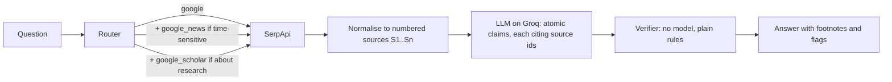

# Footnote

Search-grounded answers where every claim carries a footnote, and every footnote is checked.

Most "grounded" LLM answers attach a list of links and hope. Footnote makes the model cite a specific search
result for every sentence, then checks each citation without a model: does the cited result exist, does it contain
every number the sentence states, and how much of the sentence it actually covers. Anything that fails is flagged
in the output instead of being presented as fact.

Built on [SerpApi](https://serpapi.com) (Google, Google News and Google Scholar engines) and open-weight models
served by [Groq](https://groq.com). The model takes a second or two; search usually takes a couple more, and
occasionally over a minute (see [Evaluation](#evaluation)).

```
$ footnote "Who is the current CEO of OpenAI?"
Who is the current CEO of OpenAI?

- Sam Altman has been the chief executive officer of OpenAI since 2019. [1]
- As of February 28, 2026, Sam Altman is the CEO of OpenAI. [2]

Sources
[1] Sam Altman — Chief Executive Officer, OpenAI (siliconvalleyinvestclub.com, via google)
[2] OpenAI CEO Sam Altman answers questions on new Pentagon deal: 'This technology is super important' (foxbusiness.com, 2026-02-28, via google_news)

2/2 claims backed by their cited source | engines: google, google_news
```

<sub>A real run on 11 October 2026 with the default model, URLs and timing trimmed. A claim the checker can't back is flagged
inline, e.g. `(number not in source)`; there's a worked example under [Evaluation](#the-checker-at-work).</sub>

## How it works



1. **Route.** A small keyword router picks engines: Google always, Google News for time-sensitive wording,
   Google Scholar for research questions. It's deterministic so it's free, testable and easy to argue with.
2. **Search.** The official `serpapi` client fetches each engine. Responses are cached on disk by request, so
   re-running a question or the eval costs no extra searches.
3. **Normalise.** Answer boxes, knowledge graph, the pages an AI Overview cites (never its generated text), organic
   results, clustered news stories and Scholar results (with citation counts) become one numbered list, de-duplicated
   by URL.
4. **Answer.** A Groq-hosted model (default `openai/gpt-oss-120b`) must return claims through a forced tool call
   whose schema requires `source_ids` on every claim. It is told today's date, to copy numbers exactly and to list
   unanswered parts as gaps rather than guess. A rejected tool call is retried with the rejection shown to the
   model, and one that spent its whole token budget reasoning is retried with a larger budget.
5. **Verify.** Each claim gets one of: `supported`, `weak`, `unsupported`, `number_not_found`, `bad_citation`, or
   `abstain` for a refusal or placeholder ("I don't know", "[driver name]"), which is checked first. Numbers are
   compared after normalising (`1,200` = `1200`, `18%` = `18`), and a date counts if it agrees with the cited
   result's own date. Coverage is the share of the claim's content words found in its best cited source.

The model writes sentences; it never decides whether they're true.

## Quickstart

```bash
pip install -e .
cp .env.example .env           # add SERPAPI_API_KEY and GROQ_API_KEY; .env is git-ignored and loaded automatically
footnote --list-models          # models your key can use; Groq's catalogue changes
footnote "Who won the most recent Formula 1 Grand Prix?"
footnote "What does research say about RAG reducing hallucinations?" --format md
footnote "Brent crude price this week" --format json --engines google,google_news
footnote "Who is the current CEO of OpenAI?" --model qwen/qwen3.8-27b
```

Each question uses 1 to 3 SerpApi searches, printed after every run.

## Evaluation

`evals/run.py` asks 20 mostly time-sensitive questions twice: once through Footnote, and once to the same model
with no search (closed-book). Both sets of claims are checked against the same retrieved sources. The metrics
measure verifiability, not truth, and not whether the question was answered.

```bash
python evals/run.py                                     # writes evals/results/<timestamp>.json after every question
python evals/run.py --resume evals/results/<file>.json  # continue an interrupted run
python evals/run.py --rescore evals/results/<file>.json # re-check saved claims with the current checker, no API calls
FOOTNOTE_MODEL=qwen/qwen3.8-27b python evals/run.py      # same questions, another model, no new searches
```

Run on 11 October 2026. The 20 questions took 39 SerpApi searches (1 to 3 each). Every run reuses them from the
cache, so the second and third models cost no searches and all three answered from identical sources. Counts come
with shares because a few dozen claims can't support decimals.

**openai/gpt-oss-120b** (the default)

| | Grounded (Footnote) | Closed-book |
|---|---|---|
| Claims | 74 | 64 |
| Backed by a source | 57 of 74 (77%) | 13 of 64 (20%) |
| Weak or unsupported | 13 of 74 (18%) | 9 of 64 (14%) |
| Abstained (refusal or placeholder) | 0 of 74 (0%) | 3 of 64 (5%) |
| Numeric claims with a number not in their sources | 4 of 60 (7%) | 39 of 50 (78%) |
| Bad citations | 0 of 74 (0%) | n/a |

**qwen/qwen3.8-27b**

| | Grounded (Footnote) | Closed-book |
|---|---|---|
| Claims | 120 | 61 |
| Backed by a source | 114 of 120 (95%) | 15 of 61 (25%) |
| Weak or unsupported | 3 of 120 (2%) | 19 of 61 (31%) |
| Abstained (refusal or placeholder) | 0 of 120 (0%) | 1 of 61 (2%) |
| Numeric claims with a number not in their sources | 3 of 107 (3%) | 26 of 37 (70%) |
| Bad citations | 0 of 120 (0%) | n/a |

**openai/gpt-oss-20b**

| | Grounded (Footnote) | Closed-book |
|---|---|---|
| Claims | 77 | 62 |
| Backed by a source | 61 of 77 (79%) | 12 of 62 (19%) |
| Weak or unsupported | 14 of 77 (18%) | 13 of 62 (21%) |
| Abstained (refusal or placeholder) | 0 of 77 (0%) | 1 of 62 (2%) |
| Numeric claims with a number not in their sources | 2 of 53 (4%) | 36 of 46 (78%) |
| Bad citations | 0 of 77 (0%) | n/a |

Latency per question, grounded answers:

| | Median | p90 |
|---|---|---|
| SerpApi search, as SerpApi reports it (same searches for every model) | 2.2s | 46.4s |
| qwen/qwen3.8-27b, as Groq reports it | 0.9s | 1.1s |
| openai/gpt-oss-20b, as Groq reports it | 1.4s | 1.9s |
| openai/gpt-oss-120b | not measured | |

Search dominates, and it is lumpy: 6 of the 20 questions took over 15s at SerpApi and the slowest took 81s, each
time on the `google` engine. Model times are Groq's own queue and processing time, so they leave out the network
and the waits a free key spends on rate limits. The gpt-oss-120b run predates per-stage timing, and Groq's daily
token cap stopped its re-run; its claims and verdicts come from the same prompt and checker as the other two.

How to read the tables:

- Grounding cuts invented numbers for every model: 4 of 60, 3 of 107 and 2 of 53 grounded numeric claims had a
  number their sources lack, against 39 of 50, 26 of 37 and 36 of 46 closed-book (gpt-oss-120b, qwen, gpt-oss-20b).
- "Backed by a source" rewards copying. qwen writes more claims and more extractive ones: 40 of its 120 share at
  least 90% of their content words with the cited snippet, against 12 of 77 for gpt-oss-20b and 4 of 74 for
  gpt-oss-120b. It also tends to list what each source says instead of answering. Asked who won the most recent
  Grand Prix, it listed five F1 facts and put the answer itself under "gaps". Nothing here scores whether the
  question was answered.
- Refusals and placeholders ("I do not have…", "[driver name]") are counted as abstentions, not support. Before that
  rule, closed-book got credit for them.

### The checker at work

Asked for India's population (q03, gpt-oss-120b, in a first 5-question run the same day), the model wrote:

> Other recent estimates differ: Trading Economics estimated 1,421.0 million people for the 2025‑26 fiscal year,
> Population Pyramid reported 1,450,935,791 for 2024, and a YouTube short cited 146.39 crore (1,463,900,000).

The cited YouTube result says only "India's Population hits 146.39 crore". The model converted crore into a plain
number although it is told never to convert, and the checker flagged the claim `number_not_found`, missing
`1463900000`. Every other number in the claim matched its source after normalising.

### How often the checker is right

20 grounded verdicts were drawn at random (seed 20261011) from the gpt-oss-20b run and labelled by Claude, the AI
assistant that ran this evaluation, not by a person. Each claim was judged against exactly what the checker sees,
the cited results' titles, snippets and dates, and counted as backed only if that text states everything the claim
says. Labels and reasons are in [`evals/labels_ai.json`](evals/labels_ai.json).

The checker's call (backed means `supported`) matched the label on **13 of 20**, with 3 close calls. Twenty is a
small sample, so read it as a direction rather than a rate.

- Of 14 claims marked `supported`, 10 were backed. The 4 misses added something the source doesn't say: two gave a
  release month for models the source only ranked "as of July 2026", one narrowed what a study challenged, and one
  said "It was released on 2026-10-10", where the date was only the article's and "released" was the one content
  word left to check.
- Of 6 claims marked weak, unsupported or number_not_found, 3 were backed after all. Two combined two cited sources,
  and coverage is scored against the best single source. One said "Reserve Bank of India" where the headline said
  "RBI".

## Comparing models

Because the checker is model-free, it doubles as a judge between models: the tables above differ only in
`FOOTNOTE_MODEL`. Groq's catalogue changes (`llama-3.3-70b-versatile` was gone by October 2026), so check
`footnote --list-models` first. On a free key, gpt-oss-120b gets 8k tokens a minute and 200k a day, and one eval
run of it used about 58k.

## Limitations

- The verifier is lexical. It catches invented numbers and citations to the wrong result well, and paraphrases
  poorly: a correct sentence worded differently from its snippet can score `weak`. It agreed with an independent
  label on 13 of 20 sampled verdicts (above); a human-labelled sample of 50 or more would pin that down.
- Coverage is scored against the best single cited source, so a claim that correctly combines two cited results
  scores `weak`. And it can't see an added fact if the claim's other words match: "released in July 2026" passed
  against a page that only ranked the model "as of July 2026".
- A result's date says when it was reported, but the date rule accepts it as the date of the event. A claim with
  almost no other content words then passes on the date alone: "It was released on 2026-10-10" scored 1.0 against
  a headline published that day.
- Google News results carry a headline and no snippet, so a claim cited to news is checked against the headline
  alone, and correct paraphrases score `weak`. "The current repo rate set by the Reserve Bank of India is 5.5% as of
  October 2026" was weak against "RBI raises the Repo Rate by 25 bps to 5.5% in October, as expected": only 3 of its
  8 content words appear, because the headline says "RBI".
- Numbers inside names count as numbers. "The most recent Formula 1 Grand Prix…" is flagged `number_not_found` when
  the source doesn't happen to contain a "1". A year the model correctly infers is flagged too: from a page dated
  October 2026 that says "the year to August", the claim "the year to August 2026" fails, because only dates that
  agree with the cited result's own date are excused.
- The model doesn't always follow its rules. In q03 it turned "146.39 crore" into "1,463,900,000" despite being told
  never to convert. The checker caught it (see above), but a conversion that happened to land on a number already
  in the source would pass.
- Snippets are short. A claim can be true on the page and still not be in the snippet, which counts as a miss.
  Fetching full pages would fix this at the cost of latency.
- The closed-book comparison favours grounded answers, because grounded claims are written from the same
  snippets they're checked against. The number check is the fairer signal of the two.
- Real Google responses look different from the fixtures. None of the 20 in the eval had an answer box or
  knowledge graph. All 20 had an AI Overview, but only 7 carried it inline; the other 13 need a second, paid
  request, which Footnote doesn't make. Google News returned 1,214 results over 15 searches with no snippets and no
  story clusters. So the answer box, knowledge graph and story cluster code has only been tested on fixtures.
- Some Google results are dated relatively ("2 days ago", "15 hours ago"), which the date rule can't match.
- SerpApi's Google engine is sometimes slow: 6 of the 20 eval questions waited over 15s and one 81s. The client
  waits up to 120s, because a search that times out is still charged.
- gpt-oss models sometimes call a browsing tool they were trained with (`open`) or spend their whole token budget
  reasoning. Both are retried, which costs extra calls, and on a free Groq key (8k tokens a minute) that is slow.
- Router keywords and the abstention patterns are English-only.

## Tests

```bash
pip install -e ".[dev]" && pytest
```

The suite runs fully offline against SerpApi-shaped fixtures, trimmed real responses (`tests/fixtures/live/`) and
a fake model.

MIT licence.
