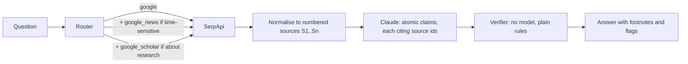

# Footnote

Search-grounded answers where every claim carries a footnote, and every footnote is checked.

Most "grounded" LLM answers attach a list of links and hope. Footnote makes the model cite a specific search
result for every sentence, then checks each citation without a model: does the cited result exist, does it contain
every number the sentence states, and how much of the sentence it actually covers. Anything that fails is flagged
in the output instead of being presented as fact.

Built on [SerpApi](https://serpapi.com) (Google, Google News and Google Scholar engines) and Claude.

```
$ footnote "What is the latest news on Mount Example?"

- Mount Example is 4,321 metres tall and was first climbed in 1911. [1]
- Park authorities closed it for the winter on October 1 after early snowfall. [2]
- Officials reported 1,450 summit attempts this year. [3]
- About 2,000 climbers reach the summit every season. [4] (number not in source)

Sources
[1] Mount Example - Wikipedia (en.wikipedia.org, via google)
[2] Mount Example closes for the winter (news.example.com, 10/02/2026, via google_news)
[3] Record season on Mount Example (times.example.com, 09/28/2026, via google_news)
[4] Climbing Mount Example | Example Alpine Club (alpine.example.org, Mar 4, 2026, via google)

3/4 claims backed by their cited source | engines: google, google_news
```

<sub>Output above comes from the offline test fixtures (a fictional mountain), so the repo runs without keys.</sub>

## How it works



1. **Route.** A small keyword router picks engines: Google always, Google News for time-sensitive wording,
   Google Scholar for research questions. It's deterministic so it's free, testable and easy to argue with.
2. **Search.** The official `serpapi` client fetches each engine. Responses are cached on disk by request, so
   re-running a question or the eval costs no extra searches.
3. **Normalise.** Answer boxes, knowledge graph, organic results, clustered news stories and Scholar results
   (with citation counts) become one numbered list, de-duplicated by URL.
4. **Answer.** Claude must return claims through a forced tool call whose schema requires `source_ids` on every
   claim. It is told to copy numbers exactly and to list unanswered parts as gaps rather than guess.
5. **Verify.** Each claim gets one of: `supported`, `weak`, `unsupported`, `number_not_found`, `bad_citation`.
   Numbers are compared after normalising (`1,200` = `1200`, `18%` = `18`). Coverage is the share of the claim's
   content words found in its best cited source.

The model writes sentences; it never decides whether they're true.

## Quickstart

```bash
pip install -e .
export SERPAPI_API_KEY=...      # https://serpapi.com/manage-api-key
export ANTHROPIC_API_KEY=...
footnote "Who won the most recent Formula 1 Grand Prix?"
footnote "What does research say about RAG reducing hallucinations?" --format md
footnote "Brent crude price this week" --format json --engines google,google_news
```

Each question uses 1 to 3 SerpApi searches, printed after every run.

## Evaluation

`evals/run.py` asks 20 mostly time-sensitive questions twice: once through Footnote, and once to the same model
with no search (closed-book). Both sets of claims are checked against the same retrieved sources.

```bash
python evals/run.py            # writes evals/results/<timestamp>.json and prints a table
```

| Metric | Grounded (Footnote) | Closed-book |
|---|---|---|
| Claims backed by a source | _run to fill_ | _run to fill_ |
| Numeric claims whose numbers aren't in any source | _run to fill_ | _run to fill_ |
| Bad citations | _run to fill_ | n/a |
| Median latency / SerpApi searches | _run to fill_ | n/a |

## Limitations

- The verifier is lexical. It catches invented numbers and citations to the wrong result well, and paraphrases
  poorly: a correct sentence worded differently from its snippet can score `weak`. Before quoting the eval
  numbers, hand-label about 50 verdicts from `evals/results/` and report how often you agree with the checker.
- Snippets are short. A claim can be true on the page and still not be in the snippet, which counts as a miss.
  Fetching full pages would fix this at the cost of latency.
- The closed-book comparison favours grounded answers, because grounded claims are written from the same
  snippets they're checked against. The number check is the fairer signal of the two.
- Router keywords are English-only.

## Tests

```bash
pip install -e ".[dev]" && pytest
```

The suite runs fully offline against SerpApi-shaped fixtures and a fake model.

MIT licence.
